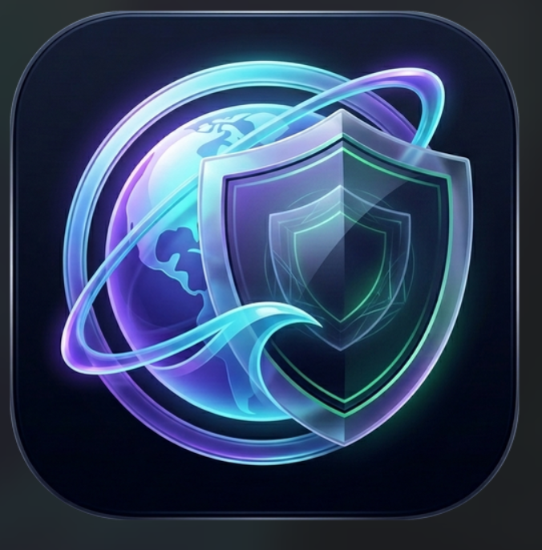

# MTK Browser

<p align="center">
  
</p>

<p align="center">
  <strong>A privacy-first, family-safe Windows browser built with C++20 and the Chromium Embedded Framework (CEF).</strong>
</p>

<p align="center">
  <a href="https://github.com/MDTahir7/mtk-browser/actions/workflows/tests.yml"></a>
  
  
  
  <a href="LICENSE"></a>
</p>

---

## Overview

**MTK Browser** is a native, modern desktop web browser engineered for security, privacy, and family safety on Windows 10 and 11. Built entirely with **C++20**, **Win32**, and the **Chromium Embedded Framework (CEF 150)**, it delivers the rendering engine of Chromium without the telemetry, tracking, or unsafe web defaults of typical consumer browsers.

The codebase features an offline, deterministic policy engine, network-layer SafeSearch enforcement, hardware-isolated credential storage, and Chromium sandbox isolation across all renderer processes.

> **Note on Architecture:** The shipped Windows application is the native C++20 Win32 codebase located in `native/`. An early Electron prototype under `src/` is retained solely for historical behavior comparison and is excluded from native installation packages.

---

## Key Features & Security Protections

### 1. Robust Content Filtering & Family Safety
- **Strict SafeSearch Enforcement**: Enforces strict filtering query parameters and headers across Google, Bing, DuckDuckGo, and YouTube.
- **YouTube Strict Mode**: Injects Google's documented `YouTube-Restrict: Strict` header into all YouTube and InnerTube API network requests.
- **Instagram Discovery Lockdown**: Redirects the Explore browse grid and discovery loops to keyword search, blocks the algorithmic Reels feed, and strips sponsored feed cards.
- **Domain & Keyword Categorization**: Blocks known adult and hazardous domains at the network boundary before HTTP dispatch.
- **Private Network Protection**: Denies navigation to private, loopback, and local network ranges (`127.0.0.0/8`, `10.0.0.0/8`, `172.16.0.0/12`, `192.168.0.0/16`, `169.254.0.0/16`, `::1`, `fc00::/7`, `fe80::/10`).

### 2. Chromium Sandbox Isolation
- Uses CEF 150's native Windows bootstrap sandbox (`MTKBrowser.exe` broker and `MTKBrowser.dll` application).
- Renderer and utility child processes execute under **Untrusted** token integrity.
- GPU acceleration process executes under **Low** token integrity.
- Sandboxed processes are restricted via Windows Less Privileged AppContainer (LPAC) ACLs. Disabling the sandbox (`--no-sandbox`) is strictly blocked.

### 3. Download Safeguards & Filename Hardening
- **Path Traversal & Device Name Sanitization**: Strips directory traversal sequences (`..`), invalid control characters, and reserved Windows DOS devices (`CON`, `PRN`, `AUX`, `NUL`, `COM1-9`, `LPT1-9`).
- **Windows Mark of the Web (MOTW)**: Automatically writes NTFS `Zone.Identifier` (Internet Zone 3) and referrer origin metadata onto finished downloads, ensuring Windows Defender and SmartScreen inspect untrusted files.
- **Safe Download Mode**: Disallows executable binaries, installer packages, and scripts (`.exe`, `.bat`, `.cmd`, `.ps1`, `.vbs`, `.js`, `.scr`, `.msi`) and detects double-extension masquerades (`.pdf.exe`).

### 4. Credential Protection & Parent PIN Lock
- **DPAPI-Encrypted Password Manager**: Encrypts user credentials with Windows Data Protection API (`CryptProtectData`) using entropy derived from the Windows user security identifier (SID) and profile ID. Plaintext passwords never touch disk.
- **Parent PIN**: Protects browser settings, download policy selection, and browsing data deletion using PBKDF2-HMAC-SHA256 (200,000 iterations, 16-byte random salt generated via Windows CNG BCrypt) with progressive delay throttling on incorrect attempts.

### 5. Cryptographically Verified Auto-Updates
- Update manifests are validated over HTTPS against a hardcoded public key using detached **ECDSA P-256** signatures via Windows Cryptography API: Next Generation (CNG).
- Downloaded installer packages are verified against signed SHA-256 digests and byte counts before any execution. Downgrades are strictly rejected.

### 6. Fingerprinting Protection & Anti-Tracking
- Strips high-entropy User-Agent Client Hints (`Sec-CH-UA-Full-Version-List`, `-Platform-Version`, `-Arch`, `-Bitness`, `-Model`, `-WoW64`).
- Perturbs Canvas 2D, WebGL, and Web Audio readback data with a seeded PRNG noise generator that is consistent within a session but changes across browser restarts.

### 7. Modern Browser Experience
- **Vertical Tabs Collapsible Rail**: Left-rail tab navigation with a 48px compact mode and 240px expanded drawer.
- **Standalone Web Apps**: Install and launch web applications in dedicated windows with slim chrome and isolated profile storage.
- **Offline Reading List**: Save articles for offline reading with single-file HTML snapshot archiving.
- **Bilingual Localization**: Seamless English and Hindi (Devanagari) interface localization via runtime text assignment.

---

## Technology Stack

| Layer | Technologies |
|---|---|
| **Language & Standard** | C++20 (`/std:c++20`, `/utf-8`, `/permissive-`) |
| **GUI & Platform** | Win32 API, GDI/DirectWrite, Windows Shell, Common Controls 6 |
| **Browser Engine** | Chromium Embedded Framework (CEF 150) / Chromium 150 |
| **Cryptography & Security** | Windows CNG (`bcrypt.dll`), Windows DPAPI (`crypt32.dll`) |
| **Imaging & Media** | Windows Imaging Component (WIC), `msimg32.dll`, DirectComposition |
| **Packaging & Installer** | Inno Setup 6 (LZMA2 ultra64 solid compression) |
| **Automation & Tooling** | CMake 3.21+, PowerShell 7+, Python 3.11+, Node.js 22 |

---

## Quick Start & Installation

Pre-compiled preview installers are published on the [GitHub Releases](https://github.com/MDTahir7/mtk-browser/releases) page:

1. Download `MTK-Browser-Setup-0.3.0-Preview.exe`.
2. Run the installer. It installs per-user into `%LOCALAPPDATA%\Programs\MTK Browser\` without requiring administrator privileges.
3. Launch **MTK Browser** from the Start Menu or Desktop shortcut.

### Unattended / Silent Installation
```cmd
MTK-Browser-Setup-0.3.0-Preview.exe /VERYSILENT /NORESTART
```

---

## Building from Source (Windows x64)

### Prerequisites

- **Windows 10** (Version 1809 / Build 17763 or later) or **Windows 11** (x64)
- **Visual Studio 2022** (v143 toolset) with the *"Desktop development with C++"* workload
- **CMake 3.21+** (available on system `PATH`)
- **Node.js 20+** and **Python 3.10+**
- **Inno Setup 6** (optional, for compiling the installer package)

### 1. Download CEF Binary Distribution
Obtain the exact CEF 64-bit minimal distribution specified in [`vendor/CEF_PIN.txt`](vendor/CEF_PIN.txt) and extract it into `vendor/cef-sdk/`.

### 2. Configure and Compile the Native Target
Open a PowerShell terminal in the repository root:

```powershell
# Configure CMake with CEF sandbox enabled
cmake -S . -B build/native-sandbox -DCEF_ROOT="vendor/cef-sdk" -A x64

# Compile the Release target (MTKBrowser.exe and MTKBrowser.dll)
cmake --build build/native-sandbox --config Release --target mtk_browser
```

### 3. Stage the Release Runtime
Stage the compiled binaries, CEF dependencies, filter rules, and media loops into `dist/MTK Browser`:

```powershell
powershell -ExecutionPolicy Bypass -File scripts/stage_release.ps1
```

You can now run `dist\MTK Browser\MTKBrowser.exe`.

### 4. Build the Windows Installer (Optional)
```powershell
npm run dist:win
```
The installer is generated at `dist/installer/MTK-Browser-Setup-0.3.0-Preview.exe`.

---

## Automated Testing

MTK Browser includes an extensive, CEF-independent C++ test suite covering policy enforcement, URL parsing, download rules, filename sanitization, session persistence, and DPAPI password round-trips.

```powershell
# Run the complete C++ logic suite and DOM fixture tests
powershell -ExecutionPolicy Bypass -File scripts/run_tests.ps1
```

The test runner will compile `build/tests/mtk_tests.exe`, execute all 260+ unit test cases, and run the Node.js password form tests (`tests/password_form_tests.cjs`).

To run script syntax checks:
```powershell
npm run check
python -m py_compile scripts\*.py *.py
```

---

## Project Roadmap

See [`docs/ROADMAP.md`](docs/ROADMAP.md) for the complete engineering roadmap. Key focus areas include:
- **Tier 1 (Release Gate)**: Verified Chromium sandbox, Authenticode release signing hooks, crash recovery.
- **Tier 2 (Daily Use Parity)**: Multi-profile isolation, vertical tabs, browsable history (`mtk://history/`), bookmark folders with Netscape HTML export, and bilingual localization.
- **Tier 3 (Advanced Protection)**: In-house replacement of third-party 3D icons, signed real-time category feeds, and WebAuthn / Passkey support.

---

## Community & Contributing

We welcome contributions from the open-source community! Please review our community guidelines before submitting code:

- [Contributing Guidelines](CONTRIBUTING.md): Setup instructions, coding standards, and PR workflows.
- [Code of Conduct](CODE_OF_CONDUCT.md): Contributor Covenant v2.1.
- [Agent Guidelines (AGENTS.md)](AGENTS.md): Architectural rules and safety invariants for AI agents and maintainers.
- [Security Policy](SECURITY.md): Responsible disclosure instructions for security vulnerabilities.

---

## Security Vulnerability Reporting

If you discover a security vulnerability or content filtering bypass, please **do not** create a public issue. Follow the instructions in [SECURITY.md](SECURITY.md) to submit a confidential report to `tomboy41@gmail.com`.

---

## License & Third-Party Notices

- **Source Code**: MTK Browser source code is licensed under the [MIT License](LICENSE).
- **Chromium & CEF**: Contains code from Chromium and the Chromium Embedded Framework, licensed under the [BSD 3-Clause License](vendor/cef-sdk/LICENSE.txt).
- **Third-Party Media & Trademarks**: Project logos, trademarks, and third-party stock-derived 3D artwork are subject to the terms and restrictions detailed in [`THIRD_PARTY_NOTICES.md`](THIRD_PARTY_NOTICES.md).
- **Compliance Baseline**: Detailed upstream and source-offer requirements are documented in [`UPSTREAM.md`](UPSTREAM.md) and [`SOURCE_OFFER_REQUIREMENTS.md`](SOURCE_OFFER_REQUIREMENTS.md).

---

## Maintainer

**Mohammad Tahir Khan** ([@MDTahir7](https://github.com/MDTahir7))  
Lead Developer & Project Maintainer
